<div align="center">

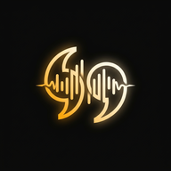

# Widgy

**Minimalist Lyric Curation App & Android Home Screen Widget**

A distraction-free, open-source Android app to curate 1–2 line poetic verses from your favorite tracks and display them as an editorial, glanceable home screen widget.

[](https://widgy.nepalbivek.com.np/)
[](https://github.com/bivekk51/widgy/releases/latest)
[](https://developer.android.com/)
[](LICENSE)

[🌐 Product Website](https://widgy.nepalbivek.com.np/) • [📦 Download Latest APK](https://github.com/bivekk51/widgy/releases/latest) • [📸 Screenshots](#-screenshots) • [✨ Themes](#-11-curated-editorial-themes) • [🛠 Architecture](#-architecture--tech-stack)

</div>

---

## 📱 Screenshots

### Daily Dashboard & Lyric Curation
| Today's Verse & Library | Instant Song Search | Stanza & Couplet Picker | Lyric Scrapbook Archive |
|:---:|:---:|:---:|:---:|
| 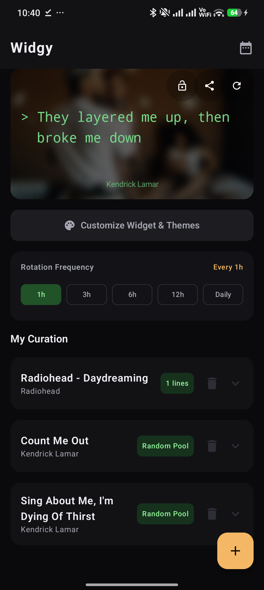 | 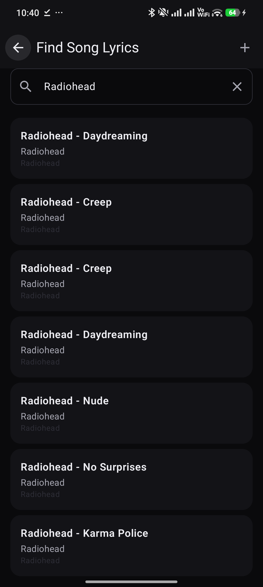 | 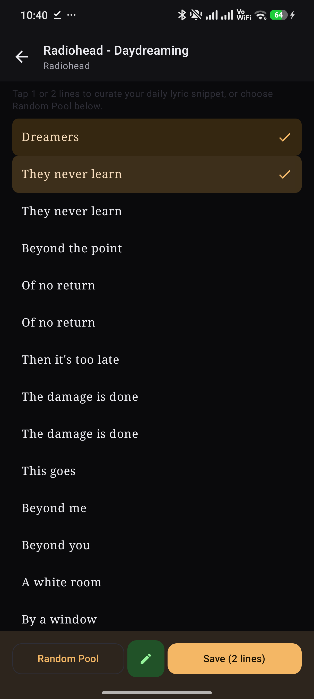 | 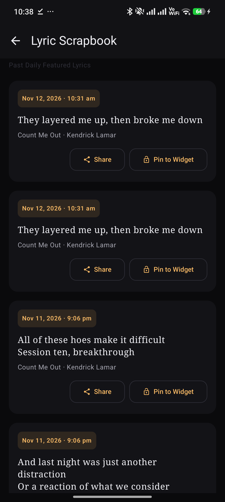 |
| *Today's lyric, rotation cadence & curated library* | *Search tracks via LRCLIB without API keys* | *Interactive 1–2 line verse selector* | *Revisit past verses, pin to widget, or share* |

### Redesigned Category-Based Theme Studio
| 01. Appearance | 02. StackBlur Intensity | 03. Typography & Sizing | 04. Expanded Preview Stage |
|:---:|:---:|:---:|:---:|
| 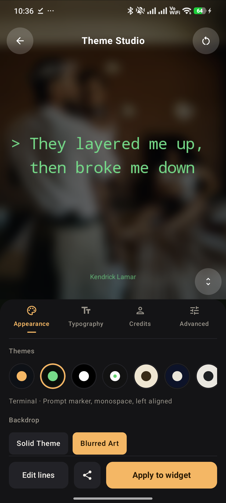 | 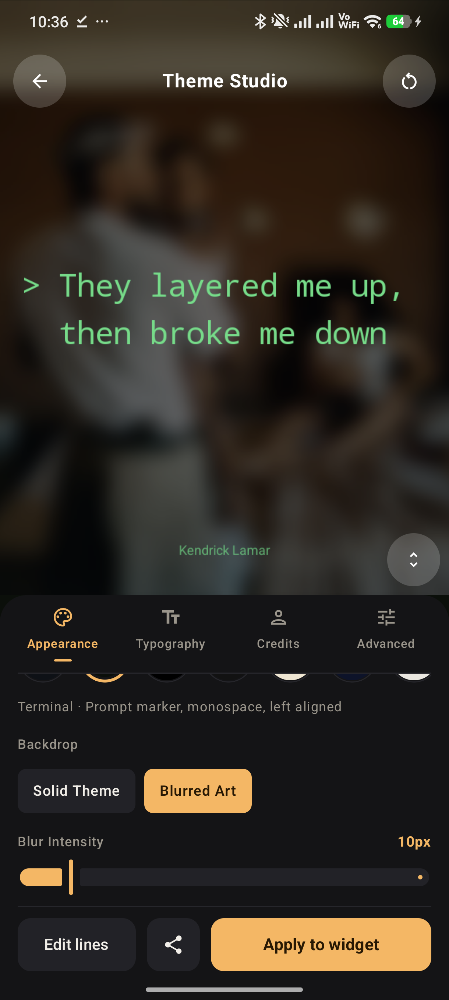 | 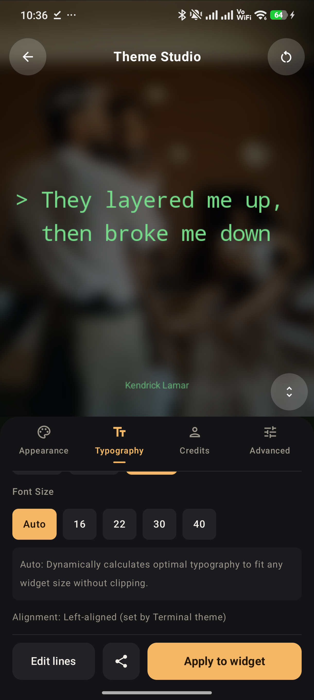 | 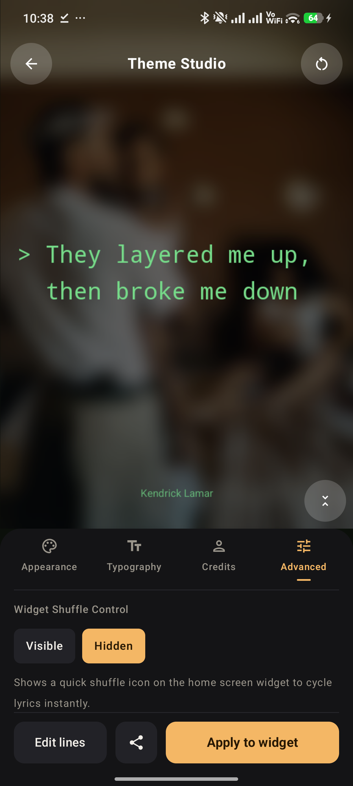 |
| *11 dual-tone swatches & artwork selector* | *Real-time StackBlur slider (6–38px)* | *Auto binary-search scaling or manual sizes* | *Tap-to-expand 1.55x full-bleed preview* |

| 05. Attribution & Credits | 06. Advanced Controls | 07. Inline Lyrics Editor |
|:---:|:---:|:---:|
| 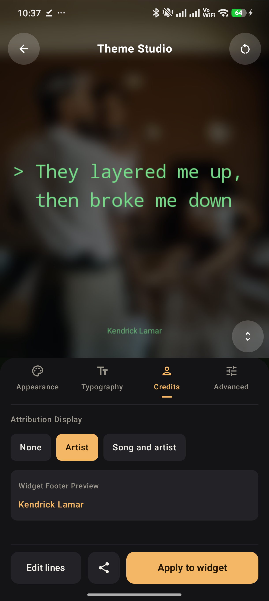 | 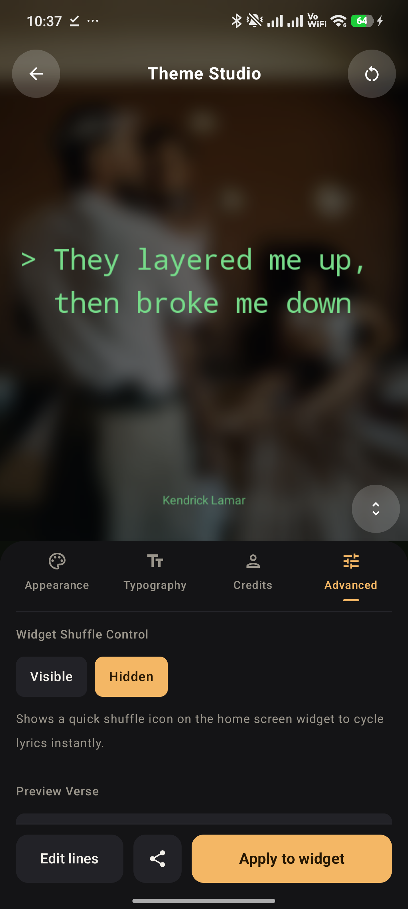 | 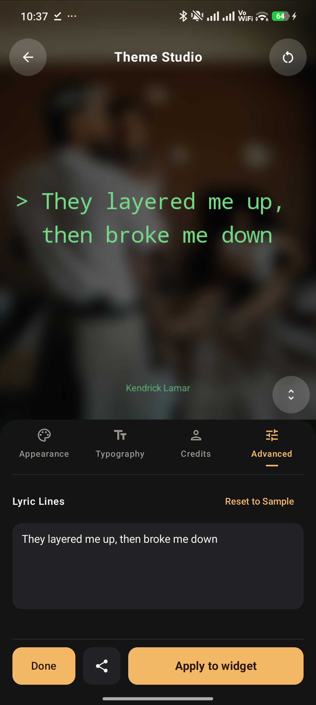 |
| *None, Artist only, or Song & Artist footers* | *Widget shuffle & sample verse cycler* | *Custom lyric override & instant reset* |

---

## ✨ Features

- **🔎 Instant Lyrics via LRCLIB**: Search millions of synced and plain lyrics instantly without API keys, accounts, or rate limits.
- **✂️ Curate 1–2 Lines**: Tap any stanza to pick the exact couplet that moves you, or let the smart Random Pool pick lines for you.
- **🎨 Category-Based Theme Studio**: Redesigned mobile customization workspace with dedicated tabs:
  - **Appearance**: 11 curated dual-tone themes, Solid Theme vs. Blurred Album Art toggle.
  - **StackBlur Engine**: Real-time Gaussian-approximation blur slider (`6px` to `38px`) with intelligent contrast scrimming for WCAG AAA legibility.
  - **Typography**: Auto-scaling binary search algorithm, custom font sizes (`16`, `22`, `30`, `40`), and multi-script Devanagari/Latin layout.
  - **Credits & Attribution**: Customizable song and artist footers (`None`, `Artist`, `Song and artist`).
  - **Advanced**: Instant widget shuffle and preview sample cycler.
  - **Expanded Preview**: Tap the preview stage for a full-bleed `1.55x` magnification inspection.
- **⚡ Instant Glance 1.1.1 Widget Updates**: Powered by Jetpack Glance with reactive DataStore preferences (`PreferencesGlanceStateDefinition`) and direct launcher host broadcast synchronization — widget updates synchronously the moment you hit "Apply to Widget".
- **⏱️ Flexible Rotation Frequency**: Set widget rotation to your preferred cadence:
  - `1h` · `3h` · `6h` · `12h` · `Daily (Midnight)`
- **📖 Lyric Scrapbook**: Never lose a verse. Past lyrics are automatically archived with timestamps. Tap any past verse to share as a social story card or pin directly to your widget.
- **📌 Pin / Lock Lyric**: Freeze your current lyric on the widget to pause rotation whenever you want to savor a line longer.
- **🇳🇵 Multi-Script Typography**: Built-in support for Devanagari (Nepali/Hindi) and Latin scripts with Noto Sans and Noto Serif fallback font splitting.
- **🔋 Zero Battery Drain & Offline-First**: No foreground services or persistent background polling. WorkManager schedules rotation, and lyrics are saved locally in SQLite via Room.

---

## 🎨 11 Curated Editorial Themes

Every theme is crafted with strict WCAG contrast adherence and unique typographic identity:

| Swatch | Theme | Family | Align | Styling & Story |
|:---:|:---|:---:|:---:|:---|
| `अ` | **Amber** | Sans | Center | Warm amber (`#FFB454`) on deep navy (`#0D1117`). Default modern identity. |
| `>` | **Terminal** | Mono | Left | Phosphor green (`#4ADE80`) on deep black (`#0A0F0A`) with `>` prompt marker. |
| `अ` | **Genius style** | Sans | Center | Stark white (`#FFFFFF`) on pitch-black (`#000000`). Bold 700 uppercase. |
| `अ` | **Spotify glow** | Sans | Center | Crisp white (`#FFFFFF`) on charcoal (`#121212`) with vibrant emerald accent bar. |
| `अ` | **Classic** | Serif | Center | Espresso ink (`#3A2A14`) on warm vintage paper (`#F1E6D0`). Italic serif. |
| `※` | **Kyoto** | Serif | Center | Soft bamboo washi silk (`#EAE5D9`) on deep midnight indigo (`#0B132B`). |
| `¶` | **Olivetti** | Mono | Left | Typewriter carbon ink (`#1C1F22`) on industrial putty ecru (`#EBE7DF`). |
| `§` | **Bordeaux** | Serif | Center | Champagne gold (`#F4E6CC`) on velvet wine burgundy (`#18090E`). Italic serif. |
| `A` | **Editorial** | Sans | Center | Stark black ink (`#121316`) on titanium ivory (`#F8F7F4`). Bold 700 uppercase. |
| `Ø` | **Nordic** | Sans | Center | Arctic mist (`#DCEBF5`) on fjord slate navy (`#0F171E`). |
| `अ` | **Botanical** | Serif | Center | Sage porcelain (`#E1EEE5`) on deep pine moss forest (`#0B160E`). |

---

## 🛠 Architecture & Tech Stack

```
com.widgy.lyrics
├── data/
│   ├── api/          # LRCLIB API client & iTunes Artwork search
│   ├── db/           # Room Database, DAOs & TypeConverters
│   ├── image/        # Native Kotlin StackBlur & ArtworkManager caching
│   ├── preferences/  # Jetpack DataStore preferences (themes, cadence, lock)
│   └── repository/   # LyricsRepository (offline cache + remote fetch)
├── domain/
│   ├── engine/       # DailyRotationEngine & rotation scheduling logic
│   ├── model/        # Song, LyricSnippet, and DailyLyric entities
│   └── theme/        # ThemeSpec, ThemeTypeface, and 11 palette definitions
├── ui/
│   ├── dashboard/    # DashboardScreen & ViewModel (today's quote, cards, cadence)
│   ├── theme/        # Category-based ThemeStudioScreen & LyricRenderer 2D engine
│   ├── lyrics/       # LyricsViewerScreen (stanza & couplet selector)
│   ├── history/      # ScrapbookScreen (past lyric archive & share actions)
│   ├── search/       # SearchScreen (LRCLIB lookup with instant results)
│   └── share/        # ShareCardHelper (Instagram/social story card export)
└── widget/           # Jetpack Glance 1.1.1 DailyLyricWidget, Worker & Receiver
```

- **UI**: 100% Kotlin + Jetpack Compose with Material 3 styling and Edge-to-Edge display.
- **Home Screen Widget**: Jetpack Glance 1.1.1 with `PreferencesGlanceStateDefinition` for reactive updates without IPC Binder crashes (`capPixels` safety).
- **Text Rendering**: Shared `LyricRenderer` combining Android 2D `Canvas` with `StaticLayout` and binary-search font size auto-scaling — guaranteeing the widget matches the in-app preview with pixel precision.
- **Database & Offline Cache**: Room Database with cascading foreign keys and SQLite indexing.
- **Background Rotation**: Android Jetpack WorkManager periodic worker with lazy on-render deterministic day hash calculation upon morning view for deep Doze mode resilience.
- **Artwork & Blur Engine**: Zero-dependency native Kotlin `StackBlur` implementation for rapid, low-memory Gaussian blur rendering on album art backdrops.

---

## 🔒 Privacy & Battery Principles

- **No Background Services**: Widgy never runs persistent background services or notification daemons. Your battery remains untouched.
- **Zero Tracking**: No analytics, no crash reporters, no ads, no telemetry, and no account requirements.
- **100% Offline-Ready**: All saved lyrics and album art are cached locally in your device's private storage.

---

## 🚀 Building & Developing

### Prerequisites
- JDK 21
- Android Studio Ladybug (2024.2.1+) or command-line SDK tools
- Android SDK Platform 35 & Build-Tools 35.0.0
- Minimum SDK: API 26 (Android 8.0 Oreo) · Target SDK: API 35 (Android 15)

### Build Commands

```bash
# Clone the repository
git clone https://github.com/bivekk51/widgy.git
cd widgy/widgy

# Run all unit tests
./gradlew testReleaseUnitTest

# Build debug APK
./gradlew assembleDebug

# Build optimized release APK
./gradlew assembleRelease

# Install directly to a connected USB / ADB device
./gradlew installDebug
```

---

## 📦 Releases & GitHub Actions

Automated builds and releases are managed via GitHub Actions:
- **Production Releases**: Push a version tag (e.g. `git tag v1.5.0 && git push origin v1.5.0`) to trigger the build, sign the APK, and publish an official release with detailed changelogs.
- **Manual Builds**: Go to **Actions** → **Build & Release APK** → **Run workflow** to download an APK artifact without publishing a release.

---

## 📄 License

Distributed under the MIT License. See [LICENSE](LICENSE) for more details.

---

<div align="center">
  <sub>Crafted with care for typography, poetry, and Android.</sub><br>
  <sub><a href="https://widgy.nepalbivek.com.np/">widgy.nepalbivek.com.np</a></sub>
</div>
